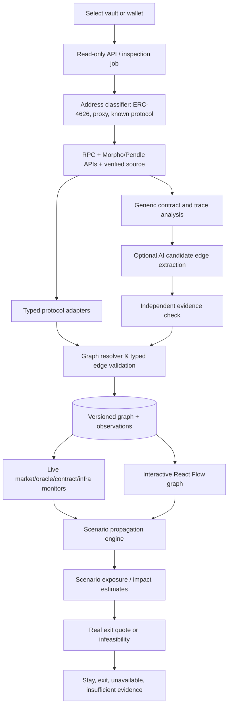

# Technical architecture: from one vault to a shared risk graph

## Runtime flow

## High-level services (target architecture, not all created)

The updated target adds `observations -> forecasts -> destination analysis -> allocation proposal -> migration simulation -> bounded delegated executor`. Implemented: experimental stablecoin price forecasts, concentration-policy partial proposals, server monitoring and a fork-only atomic execution contract. Calibrated loss/yield optimization and production wallet delegation remain separate unfinished trust boundaries. See [automatic assessment/reallocation](AUTOMATION_AND_REALLOCATION.md) and [benchmark results](BENCHMARK_RESULTS.md).

- **Next.js web**: search by chain/address, graph canvas, inspect edge, scenario panel, event timeline, cost comparison, evidence details and export.
- **TypeScript API**: `POST /inspect`, `GET /jobs/:id`, `GET /graphs/:snapshotId`, `POST /simulate`, `POST /quote-exit`, `GET /monitor/:nodeId`. Async inspection for expensive graphs. Schema validation via Zod.
- **Discovery worker**: periodically enumerate supported Morpho V1/V2/Pendle vaults with pagination; detect changes; schedule only changed/new snapshots; obey rate limits.
- **Connectors**: generic Ethereum RPC (`viem`), Morpho API, Etherscan/Sourcify, Chainlink/feed contracts, Uniswap/withdrawal quotes, optional L2BEAT/bridge/issuer data, historical archive.
- **Protocol adapters**: knowledge of each actual economic structure. `identify()`, `discoverDependencies()`, `getPositionExposure()`, `getExitMethods()`; specialized Morpho V1, Morpho V2 and Pendle PT; generic ERC-4626 has shallower coverage.
- **Contract scanner**: verified ABIs/storage/proxy/admin + interaction traces. Extract **candidate** contract edges, followed by semantic classification. Run Slither optionally in isolated worker when source/compilation available; do not treat every external call as a financial dependency.
- **Shared graph**: deduplicated components keyed by chain/address or namespaced logical ID; reverse links for affected-positions lookup. Immutable observations with evidence and block metadata.
- **Risk engine**: type-specific propagation modules, monetary exposure ledger, independent scenario assumptions; never generic risk propagation by arbitrary graph weight.
- **Decision engine**: current feasible withdraw/sell amount, quote timestamp, fees, gas, partial exit, slippage; compares **avoidable future losses** with current exit costs.

## How live inspection should work

1. Validate input `eip155:<chainId>:<address>` or UI `<chainId>:<address>`.
2. Detect `ERC4626.asset()`, ERC20 identity, code existence, proxy implementation and known factories (careful with false positives).
3. If known Morpho V1 or V2: call correct API and verify important config via on-chain reads. V2 allocates via adapters, so trace **adapter -> underlying target**; do not reuse V1 assumptions.
4. Parse market records into node/edge graph. For each edge attach evidence: provider URI, exact API field or contract call, block number if available, observed time, confidence status.
5. Resolve oracles/feeds and market accounting, preserve unresolved tokens/providers instead of creating guesses.
6. Inspect role/owner/curator and settlement chain; optional mapping to rollup/security assumptions.
7. Enumerate withdrawal methods, but **do not assume a DEX is required** if direct redemption exists.
8. Compare with cached snapshot; version any changed relationships, weights or permissions.
9. Return `{ mode, network, graph, observations, unknowns, dataFreshness, sources }`.
10. On clicking a node, compute reverse dependencies using `dependent -> dependency` semantics; optional risk event and scenario controls.

## Identity and graph temporal consistency

- Node ID: `eip155:1:0xabcd...` or `morpho-market:1:<marketId>`. Non-chain references use `issuer:<canonical-id>` etc. Never merge same address across different chains.
- Distinguish *contract* nodes from protocol brands (an entity with several contracts may be one logical protocol but multiple failure points).
- `GraphSnapshot` is a view at a specified block or time. Graph edges use historical validity interval; numeric observations (allocations/quotes/prices) have independent freshness and source.
- APIs index at different block heights. Surface mismatch and lag; prefer a single anchor block for on-chain reads when feasible. Avoid claiming true atomicity across chains and third-party APIs.
- Mark a response partial if critical contracts fail inspection or data are stale. Retain provenance to support replay/audit.
- Avoid infinite recursive scans: `(chainId,address,adapterVersion)` visited-set, maximum depth/edges, per-provider budgets and async timeouts.

## Data storage (later)

- `entities(id, kind, chain_id, address, metadata, first_seen, last_seen)`
- `edges(id, src, dst, relationship_type, status, first_seen_block, last_seen_block)`
- `evidence(id, edge_id, evidence_type, source_url, chain_id, block_number, observed_at, raw_hash)`
- `observations(entity_or_edge_id, metric, value, units, block_number, observed_at, source_id)`
- `position_snapshots(position_id, amount, value_usd, source_block, fetched_at)`
- `scenarios(id, type, target_id, severity_parameters, horizon_hours, user_assumptions)`
- `simulation_runs(snapshot_id, scenario_id, impacted_paths, exposure, loss_bounds, caveats)`
- `exit_quotes(snapshot_id, position_size, redemption_route, quote_usd, gas_usd, feasible, observed_at, expires_at)`

Use PostgreSQL first; do not mandate Neo4j before seeing query complexity. In-memory graph + SQLite/JSON is fine for initial vertical slice.

## API contracts (proposed only; implement after live CLI)

`POST /inspect` with `{chainId:1,address:"0x...",kind:"auto"}` returns job ID or snapshot.

`GET /graphs/{id}` returns `{mode,network,asOf,rootPositionId,nodes,edges,coverage,unknowns,sources}`.

`POST /simulate` with `{snapshotId,targetNodeId,scenarioKind,parameters,horizonHours}` returns affected paths, mechanisms, exposure, optional dollar-loss bounds and assumptions.

`POST /decision` with `{simulationId,positionAmount,exitQuoteId,probabilityAssumption?}` returns `STAY|EXIT|EXIT_UNAVAILABLE|INSUFFICIENT_EVIDENCE`, break-even threshold, not advice.

## Monitoring strategy

- Structural changes (new allocation/adapters, proxy upgrades, owner/curator changes): event-based when reliable + periodic reconciliation.
- Market observations (price, liquidity, oracle data, withdrawal limit): event/interval refresh with TTL and staleness indicators; no promise of tick-by-tick universal coverage.
- Incident triggers: deterministic rules on stale feeds/deviation, changed permissions, bridge/chain status, market health; later external incident feeds.
- Scenario engine reads pinned snapshot and explicit observations to preserve reproducibility.

## Architecture decisions

Start single-language TypeScript backend/core + React Flow frontend; Python Slither worker optional, not baseline. Use REST/GraphQL and `viem`. Keep adapters as libraries; don't prematurely orchestrate microservices. Add job queue/DB once load justifies it. Production scale adds backpressure, telemetry, retries, provider budgets and monitoring.
